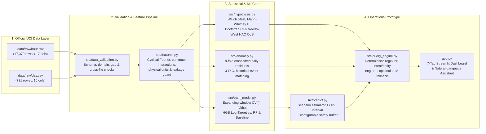
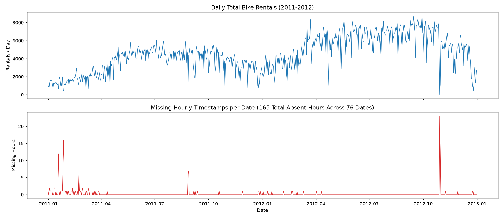
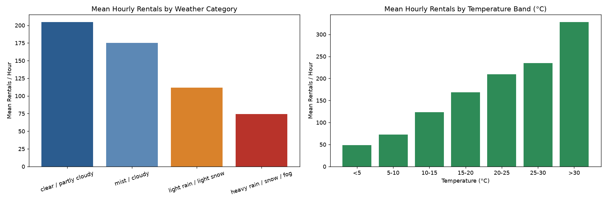
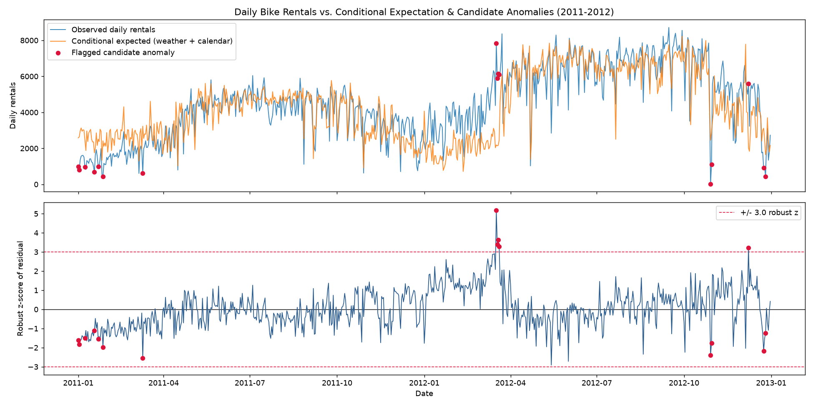

# Technical & Executive Submission Dossier: City Bike-Sharing Demand Analytics & Operations Prototype

**Prepared for:** HR & Technical Interview Panel  
**Dataset:** Official UCI Bike Sharing Dataset (Capital Bikeshare, Washington, D.C., 2011–2012)  
**Deliverables Covered:** End-to-End Data Quality & Feature Engineering • Statistical Hypothesis Testing • Time-Aware ML Demand Estimation • Interactive Natural-Language Operations Prototype • Conditional Anomaly Detection

---

## 1. Executive Answer to the Core Business Question

> **Business Problem Statement:**  
> *"Riders frequently complain about the unavailability of bikes, while several bikes remain unused across the city. Do we need to buy additional bikes, or can demand be addressed through better resource allocation and planning?"*

### Data-Grounded Verdict: **Primarily a Resource Allocation & Dynamic Scheduling Problem — Combined with Targeted Fleet Expansion for Secular Growth**

Our empirical investigation of **17,379 hourly records (`3,292,679` total rentals across 731 days)** reveals that simultaneous rider complaints ("no bikes available") and idle inventory ("unused bikes across the city") are driven by **extreme temporal concentration** rather than a high 24-hour average utilization rate:

1. **Extreme Temporal Peaking (The Root Cause of Stockouts + Idle Bikes):**
   - Across the entire two-year dataset, the **mean hourly demand is only `189.5` rentals/hour** (median **`142.0`/hour**), whereas the **99th-percentile peak reaches `782`–`977` rentals/hour**.
   - On **working days (`n = 500` days)**, **51.3% of all daily rentals occur inside just 5 commuting hours** (`07:00–08:59` and `16:00–18:59`). Demand spikes to **`477` rentals/hour at `08:00`** (90th percentile **`692`/hr**) and **`525` rentals/hour at `17:00`** (90th percentile **`782`/hr**), then drops by **more than 60% during midday (`10:00–15:00`)** and **over 95% overnight (`00:00–05:00`)**.
   - On **non-working days (`n = 231` days)**, the temporal profile flips completely: morning commute demand collapses (**`110` rentals/hr at `08:00`**), and demand shifts to a broad **midday recreational plateau (`12:00–16:00`, averaging `366–372` rentals/hr**, 90th percentile **`590–605`/hr**).
   - **Implication:** Buying more bikes without changing operations will simply leave *more* bikes sitting idle during the 19 non-peak hours of every working day. The primary lever is **predictive pre-positioning and inter-peak rebalancing** before `07:00` and between `10:00–15:30` on working days, and shifting staff to midday leisure corridors on weekends.

2. **Secular System Growth (+64.9% YoY) Requires Planned Capacity Scaling:**
   - Total annual ridership grew **+64.9%** from **`1,243,103` rentals in 2011** (`3,405.8`/day) to **`2,049,576` rentals in 2012** (`5,599.9`/day), with registered subscribers driving **81.2%** of volume.
   - Therefore, while **daily stockouts are solved by time- and weather-aware reallocation**, **long-term capacity planning** must account for the +64.9% secular shift in peak-hour demand (`08:00` and `17:00–18:00`).

3. **Critical Distinction Between "Rental Demand (`cnt`)" and "Physical Station Fleet Size":**
   - This dataset records **system-wide hourly checkouts (`cnt`)**, not station-level origin–destination flows, trip durations, or dock capacities.
   - Our machine-learning model predicts **expected system-wide hourly rental demand** with **MAE = `43.54` rentals/hr** and **$R^2 = 0.904$** (cutting baseline error by **59.4%**), and our prototype pairs this statistical prediction with an explicit, user-configurable **Operational Safety Buffer (default `+15%`)** so operations managers can translate expected checkouts into actionable shift targets without confusing operational buffers with model outputs.

---

## 2. Solution Architecture & Tech Stack

### 2.1 End-to-End Architecture

### 2.2 Technology Stack & Engineering Standards

| Layer | Technology / Library | Purpose & Engineering Rationale |
|---|---|---|
| **Language & Runtime** | Python 3.14 (`.venv`) | Reproducible, isolated virtual environment with pinned dependencies in [requirements.txt](file:///c:/Users/Asus/Downloads/bike+sharing+dataset/requirements.txt). |
| **Data Processing** | `pandas`, `numpy` | Vectorized schema validation, timestamp gap analysis, cross-table reconciliation, and cyclical feature engineering. |
| **Statistical Inference** | `scipy.stats`, `statsmodels` | Welch's $t$-test, Mann-Whitney $U$, Levene's variance test, Shapiro-Wilk, 10,000-draw bootstrap CIs, and Ordinary Least Squares with **Newey-West HAC (7-lag) standard errors** to handle serial correlation. |
| **Machine Learning** | `scikit-learn`, `joblib` | `TransformedTargetRegressor` ($\log(1+y) / \exp(\hat{y})-1$), `HistGradientBoostingRegressor` (squared-error & Poisson loss), `RandomForestRegressor`, expanding-window chronological CV, and permutation importance. |
| **Visualization** | `matplotlib`, `plotly` | Publication-grade static diagnostic figures (`outputs/figures/*.png`) and interactive Plotly charts inside Streamlit. |
| **Interactive Prototype** | `streamlit` | 7-tab operations dashboard with real-time what-if sliders, safety buffer controls, and conversational chat UI. |
| **Natural-Language Engine** | Regex Intent/Entity Parser (`re`) + Optional OpenAI-compatible API | Works **100% offline without an API key**; guarantees zero hallucinated numbers by routing every query to deterministic `pandas` / model calculations. |
| **Quality Assurance** | `pytest`, `streamlit.testing.v1.AppTest` | **24 automated unit and integration tests** verifying data integrity, leakage prevention, chronological splits, nonnegative predictions, NL intents, and headless UI execution. |

---

## 3. Deliverable 1: Data Quality Checks & Feature Engineering

**Implementation:** [src/data_validation.py](file:///c:/Users/Asus/Downloads/bike+sharing+dataset/src/data_validation.py), [src/features.py](file:///c:/Users/Asus/Downloads/bike+sharing+dataset/src/features.py), [reports/data_quality_report.md](file:///c:/Users/Asus/Downloads/bike+sharing+dataset/reports/data_quality_report.md)

### 3.1 Comprehensive Audit of the Raw Dataset
Before building any model, we ran 26 automated programmatic checks across `hour.csv` and `day.csv`:

| Check Category | Verification Performed | Empirical Result | Engineering Decision |
|---|---|---|---|
| **Dimensions & Schema** | Exact row and column counts vs. UCI specification | `hour.csv`: `17,379 × 17`; `day.csv`: `731 × 16` | **PASS** — Verified via SHA-256 and row counts. |
| **Missing & Duplicate Records** | Cell-level `NaN`, duplicate rows, duplicate `instant`, duplicate `(dteday, hr)` | `0` missing cells, `0` duplicate rows, `0` duplicate keys | **PASS** — Strictly monotonic timestamps. |
| **Component Identity** | Check `cnt == casual + registered` on every row | `0` mismatches across all 17,379 hourly and 731 daily rows | **PASS** — `casual` and `registered` are exact additive components of `cnt`. |
| **Cross-Dataset Reconciliation** | Sum `casual`, `registered`, `cnt` in `hour.csv` by `dteday` and compare to `day.csv` | `0` dates disagree (max absolute difference = `0`) | **PASS** — `day.csv` is the exact daily sum of `hour.csv`. |
| **Hourly Sequence Completeness** | Compare observed timestamps against full $731 \times 24 = 17,544$ hourly grid | **165 absent hours across 76 calendar dates** (`655` days have 24 hrs; `62` have 23 hrs; `14` have $\le 22$ hrs) | **DOCUMENTED, NOT IMPUTED** — Absent hours correspond to zero-checkout overnight hours or storm shutdowns (e.g., 23 missing hours on `2012-10-29` during Hurricane Sandy). |
| **Season Coding Audit** | Cross-tabulate `season` (`1..4`) against calendar dates | Transitions occur on astronomical equinoxes/solstices (`Mar 21`, `Jun 21`, `Sep 23`, `Dec 21`) | **CRITICAL INSIGHT** — Code `1` (labeled `springer` in README) spans ~Dec 21–Mar 20. Dashboard provides an explicit toggle between Official README and Astronomical Calendar labels. |
| **Physical Sensor Checks** | Inspect `temp`, `atemp`, `hum`, `windspeed` ranges (`[0, 1]`) | **22 rows on `2011-03-10` have `hum == 0.0`**; 2,180 rows have `windspeed == 0.0` | **FLAGGED** — `0%` humidity on a rainy day (`weathersit = 3`) is a sensor dropout; retained with documentation. |
| **Distributional Outliers** | Global IQR fence (`cnt > 642.5`) and conditional robust $z$-score ($|z_{\text{robust}}| > 3.5$ within `hr × workingday`) | `505` global IQR outliers; `438` conditional outliers | **RETAINED** — Unlike the reference R report that erased extremes via `tsclean()`, we preserve real rush-hour peaks and storm drops. |

### 3.2 Feature Engineering & Target Leakage Prevention

Every feature engineered in [src/features.py](file:///c:/Users/Asus/Downloads/bike+sharing+dataset/src/features.py) is a deterministic function of calendar and weather inputs—meaning **zero target statistics leak across time** and the exact same function transforms training batches, test batches, and single what-if scenarios in the Streamlit app:

1. **Physical De-Normalization (for human interpretability):**
   - `temp_c = temp * 41.0` ($^\circ\text{C}$), `atemp_c = atemp * 50.0` ($^\circ\text{C}$), `hum_pct = hum * 100.0` ($\%$), `windspeed_kmh = windspeed * 67.0` ($\text{km/h}$).
2. **Cyclical Fourier Encodings (preserving circular continuity at midnight, week wrap-around, and Dec $\to$ Jan):**
   $$\text{hr\_sin} = \sin\!\left(\frac{2\pi \cdot \text{hr}}{24}\right), \quad \text{hr\_cos} = \cos\!\left(\frac{2\pi \cdot \text{hr}}{24}\right)$$
   $$\text{weekday\_sin} = \sin\!\left(\frac{2\pi \cdot \text{weekday}}{7}\right), \quad \text{weekday\_cos} = \cos\!\left(\frac{2\pi \cdot \text{weekday}}{7}\right)$$
   $$\text{mnth\_sin} = \sin\!\left(\frac{2\pi \cdot (\text{mnth}-1)}{12}\right), \quad \text{mnth\_cos} = \cos\!\left(\frac{2\pi \cdot (\text{mnth}-1)}{12}\right)$$
3. **Behavioral Regime Indicators:**
   - `is_weekend`: `1` if `weekday ∈ {0, 6}` (Sunday/Saturday), `0` otherwise.
   - `is_commute_hour`: `1` if `hr ∈ {7, 8, 16, 17, 18}`, `0` otherwise.
   - `workday_commute = is_commute_hour * workingday`: Captures the sharp bimodal rush-hour regime specific to working days.
4. **Hard Guard Against Target Leakage:**
   - `casual` and `registered` sum identically to `cnt`. Including either would constitute 100% target leakage.
   - `instant` is an arbitrary row counter that proxies time linearly.
   - [`assert_no_leakage()`](file:///c:/Users/Asus/Downloads/bike+sharing+dataset/src/features.py#L90-L93) raises a `ValueError` if any of `("casual", "registered", "cnt", "instant")` ever appears in the predictor list, and is verified by unit tests.

---

## 4. Deliverable 2: Hypothesis Formulation & Statistical Testing

**Implementation:** [src/hypothesis.py](file:///c:/Users/Asus/Downloads/bike+sharing+dataset/src/hypothesis.py), [reports/hypothesis_results.md](file:///c:/Users/Asus/Downloads/bike+sharing+dataset/reports/hypothesis_results.md)

### 4.1 Pre-Registered Experimental Design
To test whether weekday commuter peaks are structurally different from weekend/holiday demand during rush hours, we fixed the experimental design in [src/config.py](file:///c:/Users/Asus/Downloads/bike+sharing+dataset/src/config.py) prior to testing:
- **Research Question:** Is bike demand during commuting hours higher on working days than on non-working days?
- **Predefined Commuting Windows:** Morning `hr ∈ {7, 8}` (`07:00–08:59`) and Evening `hr ∈ {16, 17, 18}` (`16:00–18:59`).
- **Unit of Analysis:** One calendar date ($N = 731$ days), where the outcome $Y_d = \sum_{h \in \{7,8,16,17,18\}} \text{cnt}_{d,h}$ is the daily commuting-window rental total. Aggregating to the daily level avoids pseudoreplication across hours within the same day.
- **Null Hypothesis ($H_0$):** $\mu_{\text{working}} = \mu_{\text{non-working}}$
- **Alternative Hypothesis ($H_1$, one-sided):** $\mu_{\text{working}} > \mu_{\text{non-working}}$ at significance level $\alpha = 0.05$.

### 4.2 Statistical Test Results & Robustness Checks

| Analysis / Subset | $n_{\text{work}}$ / $n_{\text{non-work}}$ | Working Mean (Median) | Non-Working Mean (Median) | Mean Diff (95% Welch CI) | Welch $t$ ($\text{df}$) | One-Sided $p$-Value | Effect Size (Hedges' $g$) |
|---|---|---|---|---|---|---|---|
| **Primary (All 731 Days)** | 500 / 231 | **2,068.5** (2,078.0) | **1,105.2** (1,096.0) | **+963.3** ([858.0, 1,068.7]) | 17.96 (645.6) | **$4.33 \times 10^{-59}$** | **1.23** |
| **Complete 5-Hr Windows Only** | 495 / 230 | 2,087.8 (2,085.0) | 1,109.9 (1,100.0) | **+977.9** ([873.4, 1,082.4]) | 18.39 (647.8) | **$3.89 \times 10^{-61}$** | **1.27** |
| **2011 Only (`yr = 0`)** | 250 / 115 | 1,561.7 (1,634.5) | 884.7 (891.0) | **+677.0** ([570.6, 783.4]) | 12.53 (286.6) | **$1.48 \times 10^{-29}$** | **1.24** |
| **2012 Only (`yr = 1`)** | 250 / 116 | 2,575.4 (2,659.5) | 1,323.7 (1,341.0) | **+1,251.8** ([1,108.8, 1,394.8]) | 17.24 (311.3) | **$2.87 \times 10^{-46}$** | **1.77** |
| **Weekends Only (Excl. 21 Holidays)** | 500 / 210 | 2,068.5 (2,078.0) | 1,107.0 (1,097.0) | **+961.5** ([855.2, 1,067.8]) | 17.77 (611.6) | **$2.72 \times 10^{-57}$** | **1.23** |

- **Nonparametric Confirmation:** Mann-Whitney $U = 94,178$, one-sided $p = 3.65 \times 10^{-43}$, rank-biserial correlation $r = 0.63$; 10,000-draw bootstrap 95% CI for the mean difference is **[857.3, 1,069.2]**.
- **Accounting for Serial Dependence & Weather Confounding:**
  - Group-demeaned daily residuals exhibit lag-1 autocorrelation $r_1 = 0.79$ ($\text{Durbin-Watson} = 0.41$) because ridership evolves smoothly across seasons and weather spells.
  - We therefore estimated an Ordinary Least Squares model with **Newey-West HAC standard errors (`maxlags = 7`)** controlling for quadratic temperature, humidity, wind speed, worst daily weather code, month fixed effects, and year:
    $$\log(1 + \text{commute\_total}_d) = \beta_0 + \beta_1 \text{workingday}_d + \beta_2 \text{temp}_d + \beta_3 \text{temp}_d^2 + \beta_4 \text{hum}_d + \beta_5 \text{windspeed}_d + \gamma_{\text{weathersit}} + \delta_{\text{mnth}} + \theta \text{yr}_d + \varepsilon_d$$
  - Even after controlling for all weather and calendar confounders ($R^2 = 0.682$), working days carry **$e^{\hat{\beta}_1} = 1.89\times$** (95% CI **[1.77×, 2.02×]**, HAC $z = 19.50$, one-sided $p = 5.85 \times 10^{-85}$) the commuting-window demand of non-working days (linear-scale adjusted difference **+927.9 rentals/day**, 95% CI **[848.0, 1,007.9]**).
- **Secondary Weather Hypothesis ($H_2$):** Days experiencing any precipitation (`weathersit >= 3`, $n = 300$) average **4,014 rentals/day** vs. **4,846 rentals/day** on dry/mist days ($n = 431$): Welch one-sided $p = 3.02 \times 10^{-9}$, Mann-Whitney $p = 1.24 \times 10^{-8}$, with an average within-season-year drop of **-829 rentals/day**.

---

## 5. Deliverable 3: Hourly Demand-Estimation Model

**Implementation:** [src/train_model.py](file:///c:/Users/Asus/Downloads/bike+sharing+dataset/src/train_model.py), [src/predict.py](file:///c:/Users/Asus/Downloads/bike+sharing+dataset/src/predict.py), [reports/model_results.md](file:///c:/Users/Asus/Downloads/bike+sharing+dataset/reports/model_results.md)

### 5.1 Chronological Validation & Split Design (Zero Future Leakage)
Random train/test splitting is invalid for time-series demand estimation because adjacent hours share identical weather and unobserved demand shocks. We implemented a **two-stage chronological evaluation protocol**:

1. **Development Window (`2011-01-01 00:00` to `2012-06-30 23:00` — 13,003 hours, 18 months):**
   - Used for hyperparameter tuning via **4 expanding-window (rolling-origin) validation folds**:
     - Fold 1: Train `2011-01..2011-06` $\to$ Validate `2011-Q3` (`Jul–Sep 2011`)
     - Fold 2: Train `2011-01..2011-09` $\to$ Validate `2011-Q4` (`Oct–Dec 2011`)
     - Fold 3: Train `2011-01..2011-12` $\to$ Validate `2012-Q1` (`Jan–Mar 2012`)
     - Fold 4: Train `2011-01..2012-03` $\to$ Validate `2012-Q2` (`Apr–Jun 2012`)
2. **Final Hold-Out Test Window (`2012-07-01 00:00` to `2012-12-31 23:00` — 4,376 hours, 6 months):**
   - Evaluated **once** after locking the winning model family and hyperparameters from the development folds.
3. **Why We Also Ran a Strict `2011 Train -> 2012 Test` Experiment:**
   - Because system ridership grew **+64.9%** between 2011 (`yr = 0`) and 2012 (`yr = 1`), any model trained exclusively on 2011 has zero variation in the `yr` feature and cannot learn the 2012 level shift.
   - We ran both splits to quantify this exact phenomenon: on the strict `2011 -> 2012` split, `hgb_log` still beats the baseline (`RMSE 128.33` vs. `157.05`, $R^2 = 0.623$ vs. `0.435`), but suffers a **`-89.65` rentals/hr negative bias** because it predicts at 2011 volume levels. Including `Jan–Jun 2012` in the development set allows the model to calibrate `yr = 1` while keeping `Jul–Dec 2012` strictly out-of-sample.

### 5.2 Quantitative Model Comparison

| Model Family | Best Hyperparameters (from Dev CV) | Dev CV RMSE | Dev CV MAE | Hold-Out Test MAE | Hold-Out Test RMSE | Hold-Out Test $R^2$ | Hold-Out Mean Bias |
|---|---|---:|---:|---:|---:|---:|---:|
| **Baseline (`hr × workingday` mean)** | Historical lookup table | 105.22 | 73.46 | 107.21 | 150.35 | 0.532 | -87.26 |
| **Random Forest (`rf_log`)** | `max_features=1.0, min_samples_leaf=1` | 77.96 | 52.80 | — | — | — | — |
| **HistGradientBoosting (`hgb_poisson`)** | `lr=0.05, max_leaf_nodes=31, min_samples_leaf=50` | 69.64 | 46.09 | — | — | — | — |
| **Selected: `hgb_log` ($\log(1+y)$ HGB)** | `lr=0.05, max_leaf_nodes=31, min_samples_leaf=50, l2=1.0` | **68.62** | **45.78** | **43.54** | **68.18** | **0.904** | **-26.11** |

- **59.4% MAE Reduction & 54.7% RMSE Reduction:** On the held-out `Jul–Dec 2012` test set (mean actual demand = `254.1` rentals/hr), `hgb_log` achieves **MAE = `43.54` rentals/hr**, **RMSE = `68.18` rentals/hr**, and **$R^2 = 0.904$**.
- **Well-Calibrated 80% Prediction Intervals:** Using out-of-fold 10th and 90th residual percentiles binned by predicted demand level on the development data, empirical coverage on the unseen `Jul–Dec 2012` test set is **79.8%** (target: **80.0%**).
- **Nonnegative-Output Policy:** Combining the $\log(1+y)$ target transform with `np.clip(pred, 0.0, None)` guarantees that predictions and interval lower bounds are strictly nonnegative ($\ge 0$) under all possible inputs.

---

## 6. Deliverable 4: Natural-Language Operations Prototype & Stretch Anomaly Detection

**Implementation:** [app.py](file:///c:/Users/Asus/Downloads/bike+sharing+dataset/app.py), [src/query_engine.py](file:///c:/Users/Asus/Downloads/bike+sharing+dataset/src/query_engine.py), [src/analysis.py](file:///c:/Users/Asus/Downloads/bike+sharing+dataset/src/analysis.py), [src/anomaly.py](file:///c:/Users/Asus/Downloads/bike+sharing+dataset/src/anomaly.py)

### 6.1 How the Deterministic Natural-Language Engine Works
Rather than wrapping an LLM around raw text and risking hallucinated metrics, [src/query_engine.py](file:///c:/Users/Asus/Downloads/bike+sharing+dataset/src/query_engine.py) implements a **two-stage deterministic NLU pipeline**:
1. **Entity Extraction (`extract_entities`)**: Extracts hours (`8 AM`, `17:00`, `morning rush`), weather categories (`clear`, `light rain`, `heavy snow`), physical weather values (`22°C`, `60% humidity`, `15 km/h`), day types (`working day`, `weekend`, `holiday`), specific weekdays, months, seasons, and years (`2011`, `2012`).
2. **Intent Classification (`detect_intent`) & Grounded Execution (`HANDLERS`)**: Maps the query to one of 12 verified analytical handlers (`peak_hours`, `compare_day_types`, `weather_effect`, `season_average`, `predict`, `monitor_hours`, `hypothesis`, `model_performance`, `anomalies`, `trend`, `hourly_pattern`, `overview`). Every number, table, and chart is computed live from the validated dataset or trained model bundle. If a question is out of scope, the engine explicitly states that it will not guess and displays supported query templates.

### 6.2 Sample Computed Outputs for Core Operations Questions

| Manager's Natural-Language Question | Detected Intent | Computed Grounded Response Summary |
|---|---|---|
| *"When is bike demand highest on working days?"* | `peak_hours` | Highest at **`17:00`** (**`525` rentals/hr**, 90th pct **`782`**), followed by **`18:00`** (**`492`/hr**, 90th pct **`731`**) and **`08:00`** (**`477`/hr**, 90th pct **`692`**). |
| *"Compare demand on working days and non-working days."* | `compare_day_types` | Working days average **`4,585` rentals/day** (bimodal peaks at `08:00` and `17:00`, **84% registered**) vs. **`4,330` rentals/day** on non-working days (single midday plateau `12:00–16:00` at **`372`/hr**, **69% registered**). |
| *"How does weather affect rental demand?"* | `weather_effect` | Controlling for `(hr, workingday, yr, mnth)`: **Clear** is **`+8%`** (`205`/hr), **Mist** is **`-7%`** (`175`/hr), **Light rain/snow** is **`-40%`** (`112`/hr), and **Heavy rain/snow** is **`-66%`** (`74`/hr, $n=3$ hrs). |
| *"What is the average demand in summer?"* | `season_average` | Under official README labels (`season = 2`, ~21 Mar–20 Jun): **`4,992` rentals/day** (`208`/hr). Under calendar summer (`season = 3`, ~21 Jun–22 Sep): **`5,644` rentals/day** (`236`/hr). |
| *"Estimate bike rentals at 8 AM in summer on a working day."* | `predict` | Expected demand: **`578` rentals/hr** (indicative 80% range **`461–691`**; baseline = `477`). With default `+15%` safety buffer: **`665` bikes** planning target. |
| *"Compare expected demand during clear weather and light rain."* | `predict` | Full-day working-day profile in summer: **Clear weather** $\to$ **`6,003` rentals/day** (peak `17:00` at `673`/hr) vs. **Light rain** $\to$ **`3,764` rentals/day** (peak `17:00` at `451`/hr) — a **37% drop**. |
| *"Which hours should the operations team monitor most closely?"* | `monitor_hours` | Ranked by 90th-percentile busy-day load: 1) **Working day `17:00`** (`p90 = 782`), 2) **Working day `18:00`** (`p90 = 731`), 3) **Working day `08:00`** (`p90 = 692`), 4) **Working day `16:00`** (`p90 = 524`), 5) **Working day `19:00`** (`p90 = 523`), 6) **Non-working day `13:00–15:00`** (`p90 = 590–605`). |

### 6.3 Stretch Goal: Conditional Anomaly & Event Detection
Instead of flagging raw high-demand days, [src/anomaly.py](file:///c:/Users/Asus/Downloads/bike+sharing+dataset/src/anomaly.py) uses 8-fold contiguous block cross-fitting on `day.csv` to compute expected 24-hour demand given season, year, month, holiday, weekday, working day, and weather, flagging days where $|z_{\text{robust}}| \ge 3.0$ or shortfall $\le -60\%$:
- **Hurricane Sandy (`2012-10-29` & `2012-10-30`)**: Flagged with **22 actual vs. 2,451 expected rentals (-99.1%)** on Oct 29 (only 1 hour logged before system suspension) and **1,096 actual vs. 2,855 expected (-61.6%)** on Oct 30.
- **Winter Blizzards & Ice Storms (`2011-01-27` & `2011-01-18`)**: Flagged with **431 actual vs. 2,418 expected (-82.2%)** and **683 actual vs. 1,750 expected (-61.0%)**.
- **Unmodeled Holiday Eves (`2012-12-24` & `2012-12-26`)**: Christmas Eve (coded as `workingday = 1` in raw data) had **920 actual vs. 3,115 expected (-70.5%)**.
- **Cherry Blossom & St. Patrick's Day Surge (`2012-03-17`)**: Flagged as the largest positive anomaly with **7,836 actual vs. 2,187 expected (+258.2%, $z_{\text{robust}} = +5.18$)**.

---

## 7. Key Interview Talking Points (Methodology, Assumptions & Trade-offs)

When discussing this project during the technical and product interview rounds, highlight these five engineering decisions:

1. **Why We Audited & Replaced the Reference R ARIMA Approach:**
   - The legacy `time-series-analysis.Rmd` ran `forecast::tsclean()`, `ma(order=7)`, and `stl()` across the *entire* 731-day series before taking a holdout slice (`700:725`), leaking future observations into the training series and erasing real events like Hurricane Sandy. Our Python pipeline splits strictly by timestamp before any fitting occurs.
2. **Why `casual` and `registered` Must Be Excluded:**
   - Because `cnt = casual + registered` is an accounting identity, using either sub-count to predict `cnt` leaks the target. In production, neither sub-count is known ahead of the hour being forecast.
3. **Why We Used Expanding-Window Validation + an 18-Month Development Split:**
   - Random K-fold cross-validation leaks contemporaneous weather and demand regimes from hour $t+1$ into hour $t$. Expanding-window CV respects causal time ordering. Including `Jan–Jun 2012` in development (and holding out `Jul–Dec 2012` for final testing) allows tree-based models to learn the `+64.9%` 2012 expansion regime without touching the 6-month test set.
4. **Why We Used Log-Target Gradient Boosting (`hgb_log`) Over Linear or Pure ARIMA Models:**
   - Bike rental counts are nonnegative, right-skewed, and driven by strong non-linear interactions (`hr × workingday` and `temp × hum × weathersit`). Fitting `HistGradientBoostingRegressor` on $\log(1 + \text{cnt})$ naturally models multiplicative weather effects, prevents negative predictions, and reduces test MAE by **59.4%** over the conditional baseline.
5. **How to Extend This System if Station-Level Telemetry Becomes Available:**
   - Adding raw trip logs (`start_station_id`, `end_station_id`, `start_time`, `end_time`) and dock status snapshots (`bikes_available`, `docks_available`) would allow us to model **net station flow ($\text{inflow}_{s,t} - \text{outflow}_{s,t}$)**, detect **censored demand** (when an empty station records `0` checkouts despite high true demand), and formulate a **capacitated vehicle routing problem (CVRP)** for rebalancing trucks.
