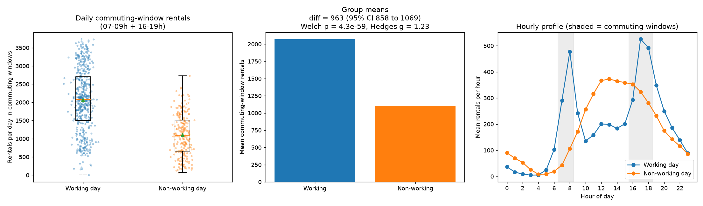

# Hypothesis Test Results

Generated by `python -m src.hypothesis`. All numbers below are computed from `data/raw/hour.csv`.

## Design (fixed before testing)

- **Research question:** Is bike demand during commuting hours higher on working days than on non-working days?
- **H0:** The mean daily rental total across the commuting windows is the same for working and non-working days.
- **H1:** The mean daily rental total across the commuting windows is higher on working days.
- **Commuting windows:** 07:00-08:59 and 16:00-18:59 (hr values 7-8 and 16-18).
- **Unit of analysis:** calendar date; outcome = sum of `cnt` over the five commuting hours.
- **Significance level:** alpha = 0.05 (one-sided).
- **Primary test:** Welch's independent-samples t-test (unequal variances).
- **Robustness:** Mann-Whitney U, bootstrap CI (10,000 resamples), complete-window days only, per-year tests, excluding holidays, and weather/season-adjusted OLS with Newey-West (HAC, 7 lags) SEs.

## Primary result

| Statistic | Working days | Non-working days |
|---|---|---|
| n (days) | 500 | 231 |
| Mean | 2068.5 | 1105.2 |
| Median | 2078.0 | 1096.0 |
| SD | 862.9 | 566.4 |

- Difference in means (working - non-working): **963.3 rentals/day** (ratio 1.87x)
- 95% CI (Welch): [858.0, 1068.7]; bootstrap 95% CI: [857.3, 1069.2]
- Welch t = 17.96, df = 645.6, one-sided p = 4.33e-59
- Effect size: Cohen's d = 1.23, Hedges' g = 1.23
- Mann-Whitney U = 94178, one-sided p = 3.65e-43, rank-biserial r = 0.63
- **Decision:** Reject H0 at alpha = 0.05.

## Assumption checks

- Normality (Shapiro-Wilk): p = 4.53e-07 (working), 0.00307 (non-working); skewness -0.09 / 0.22. With n > 200 per group the CLT makes the t-test on means reasonably robust; the Mann-Whitney test and bootstrap CI do not assume normality.
- Equal variances (Levene, median-centred): p = 6.34e-10. Welch's test does not assume equal variances.
- Independence: lag-1 autocorrelation of group-demeaned daily totals = 0.79 (Durbin-Watson 0.41). Days are serially dependent (trend, seasons, weather spells), so the simple tests overstate the effective sample size. The HAC-adjusted regression below addresses this.

## Sensitivity analyses

| Analysis | n work / non-work | Mean diff | 95% CI (Welch) | Welch p (1-sided) | Hedges g |
|---|---|---|---|---|---|
| Complete commuting windows only | 495 / 230 | 977.9 | [873.4, 1082.4] | 3.89e-61 | 1.27 |
| 2011 only | 250 / 115 | 677.0 | [570.6, 783.4] | 1.48e-29 | 1.24 |
| 2012 only | 250 / 116 | 1251.8 | [1108.8, 1394.8] | 2.87e-46 | 1.77 |
| Weekends only (holidays excluded) | 500 / 210 | 961.5 | [855.2, 1067.8] | 2.72e-57 | 1.23 |

### Weather- and season-adjusted model (confounding + serial dependence)

`log_commute ~ workingday + temp + I(temp**2) + hum + windspeed + C(weathersit_max) + C(mnth) + yr` estimated by OLS with Newey-West HAC standard errors (7 lags), n = 731, R^2 = 0.682.

- Working-day multiplier on commuting-window rentals: **1.89x** (95% CI 1.77-2.02), HAC z = 19.50, one-sided p = 5.85e-85.
- Linear-scale adjusted difference: 927.9 rentals/day (95% CI 848.0 to 1007.9).

## Secondary hypothesis (weather)

H0: mean daily rentals are equal on rainy and non-rainy days; H1: lower on rainy days. Rainy day = at least one hour with weathersit >= 3 (light rain/snow or worse).

- Non-rainy days: n = 431, mean 4846, median 4795
- Rainy days: n = 300, mean 4014, median 4101
- Welch one-sided p = 3.02e-09; Mann-Whitney one-sided p = 1.24e-08
- Mean within season-year difference (8 strata): 829 rentals/day

## Conclusion (plain English)

On working days, the five commuting hours carry on average about 963 more rentals per day than on weekends and holidays (2069 vs 1105, about 1.9x). The difference is statistically significant under every test and sensitivity check above, including after adjusting for weather, month and year with serial-correlation-robust standard errors. The standardised effect is large (Hedges' g 1.23).

## Limitations

- Observational data: this is an association, not a causal effect of 'working day' status. Working days differ from non-working days in many ways (commuter mix, events, tourism).
- Commuting windows are a design choice; results could differ for other windows. They were fixed in `src/config.py` before running the test.
- Holidays are few (21 dates) and grouped with weekends.
- Missing hourly records (165 absent hours across the series; 6 dates have an incomplete commuting window) are treated as zero rentals in the window sum; the complete-window sensitivity analysis checks this.
- System growth between 2011 and 2012 inflates variance; per-year tests and the `yr` control address this.
