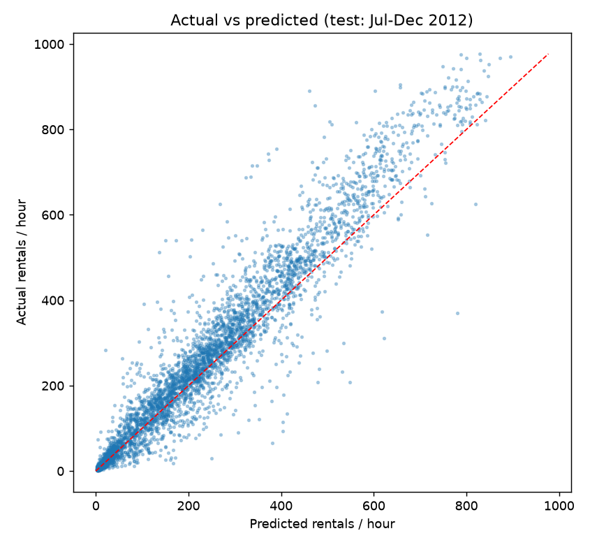

# Demand Model Results

Generated by `python -m src.train_model`. Every number is produced by that script run; nothing is hand-entered.

## Design

- Target: hourly `cnt`. Features (21): `hr, weekday, mnth, season, yr, holiday, workingday, is_weekend, weathersit, temp, atemp, hum, windspeed, hr_sin, hr_cos, weekday_sin, weekday_cos, mnth_sin, mnth_cos, is_commute_hour, workday_commute`.
- Excluded for leakage: `casual`, `registered` (sum to the target) and `instant` (row index).
- Development period: 2011-01-01 00:00:00 to 2012-06-30 23:00:00 (13,003 hours).
- Final test period: 2012-07-01 00:00:00 to 2012-12-31 23:00:00 (4,376 hours), used once after selection.
- Model selection: rolling-origin validation with four 3-month blocks inside the development period (each block predicted by a model trained only on earlier data); lowest mean RMSE wins.
- Nonnegative-output policy: predictions are clipped at 0.

## Cross-validation (development period only)

| Family | Best params | CV mean RMSE | CV mean MAE |
|---|---|---|---|
| baseline | `{}` | 105.22 | 73.46 |
| hgb_log | `{'learning_rate': 0.05, 'max_leaf_nodes': 31, 'min_samples_leaf': 50, 'l2_regularization': 1.0}` | 68.62 | 45.78 |
| hgb_poisson | `{'learning_rate': 0.05, 'max_leaf_nodes': 31, 'min_samples_leaf': 50, 'l2_regularization': 1.0}` | 69.64 | 46.09 |
| rf_log | `{'max_features': 1.0, 'min_samples_leaf': 1}` | 77.96 | 52.80 |

**Selected:** `hgb_log` with `{'learning_rate': 0.05, 'max_leaf_nodes': 31, 'min_samples_leaf': 50, 'l2_regularization': 1.0}` (CV RMSE 68.62 vs baseline 105.22). Full grid: `outputs/model_metrics.json`.

## Final hold-out test (Jul-Dec 2012)

| Model | MAE | RMSE | R^2 | Mean bias |
|---|---|---|---|---|
| Baseline: mean by hour x working day | 107.21 | 150.35 | 0.532 | -87.26 |
| Selected model (hgb_log) | 43.54 | 68.18 | 0.904 | -26.11 |

- Improvement over baseline: MAE -59.4%, RMSE -54.7%.
- Mean actual demand in test period: 254.1 rentals/hour.
- Daily totals (sum of hourly predictions): model MAE 806, R^2 0.724; baseline MAE 2408, R^2 -1.327.
- Indicative 80% range (from development out-of-fold residuals) covered 79.8% of test hours.

## Residual diagnostics (test)

- Mean residual 26.11, median 13.47, 5th-95th percentile [-52.9, 138.2].
- Lag-1 autocorrelation of hourly residuals: 0.58 (errors persist across consecutive hours - e.g. a whole rainy afternoon - because the model uses no lagged demand).
- Errors grow with demand level (heteroscedastic), as expected for count data.

Top permutation importances (RMSE increase on test): `hr` 131.8, `workday_commute` 59.4, `hr_sin` 38.6, `hr_cos` 33.0, `temp` 23.0, `hum` 19.3.

## Secondary experiment: train 2011 only, test all of 2012

| Model | MAE | RMSE | R^2 | Mean bias |
|---|---|---|---|---|
| Baseline | 108.52 | 157.05 | 0.435 | -91.87 |
| Selected config | 92.34 | 128.33 | 0.623 | -89.65 |

With no 2012 data in training, both models under-predict systematically (negative bias) because demand grew strongly between years and tree models cannot extrapolate a level shift. This is why the primary design uses an 18-month development window that includes early-2012 data.
